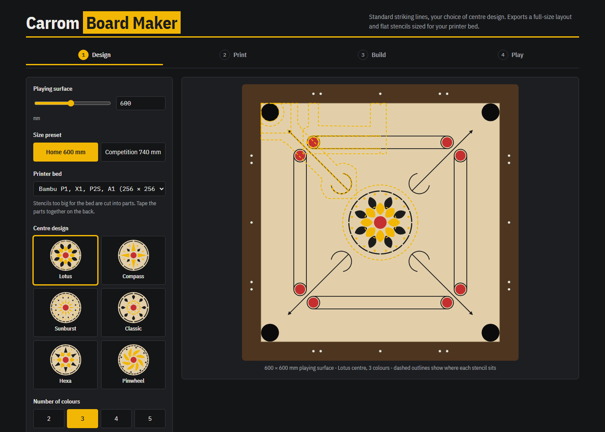
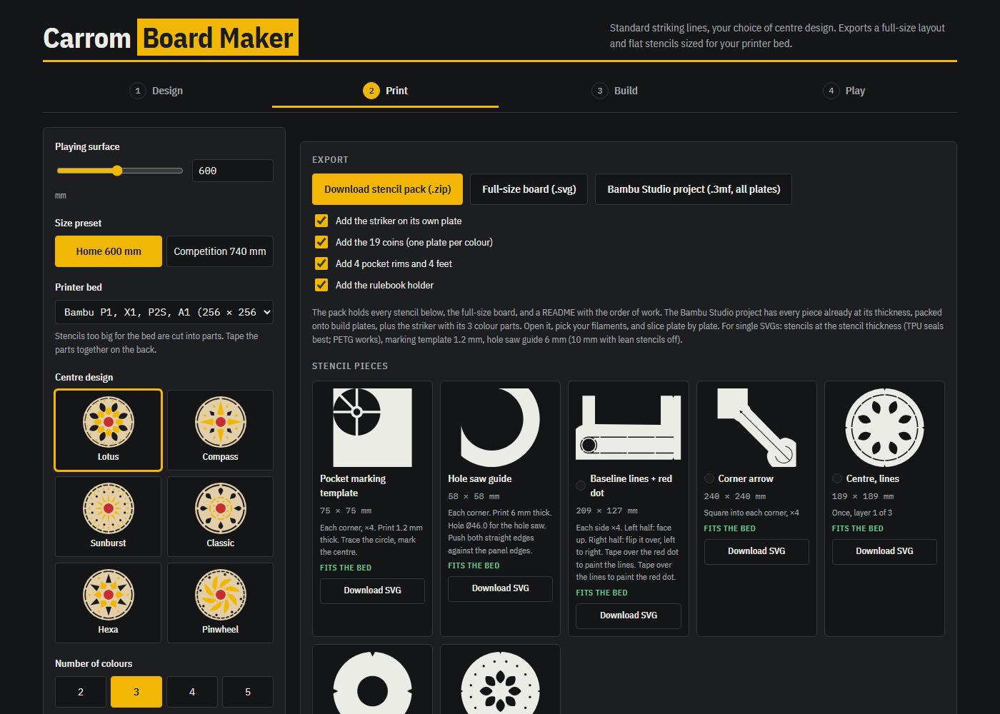
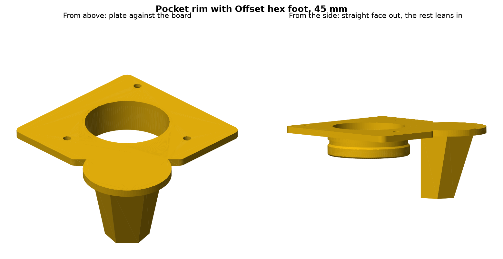
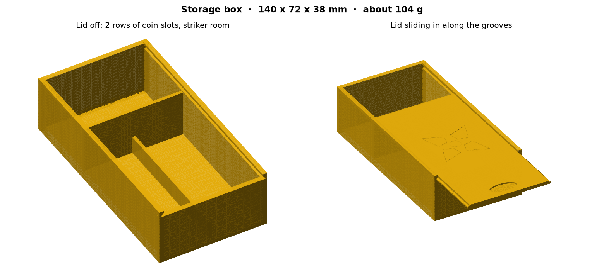
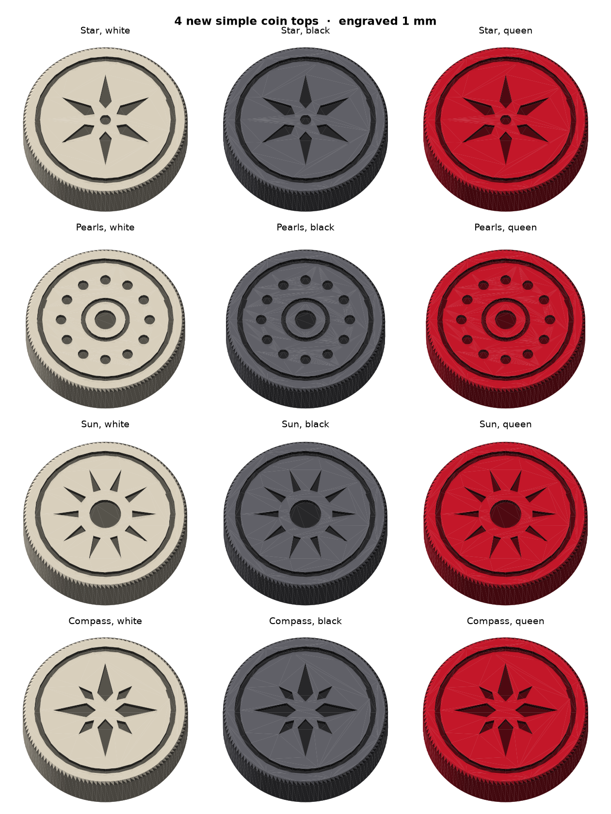
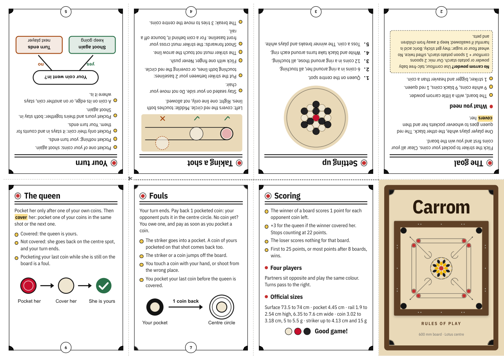

# Carrom Board Maker

**Design and build your own carrom board.** A free tool that runs in your browser. Nothing to install.

👉 **Open it: https://hugotremolo.github.io/carrom-board-maker/**

## What it does

Pick a board size and a centre design. The tool gives you everything to paint and finish the board:

- **Paint stencils** for every line: baselines and red circles, corner arrows, and the centre design (6 designs, 2 to 5 colours). "Lean" stencils use about a third of the plastic.
- **Pocket guides**: a marking template and a hole saw guide for each corner.
- **Any printer bed**: stencils too big for your bed are cut into parts automatically.
- **3D prints**:
  - a striker with 8 bottom designs, multi-colour with an AMS
  - 19 coins weighted to 5.2 g, with 8 engraved top designs (Plain, Rings, Waves, Mandala, Star, Pearls, Sun, Compass)
  - pocket rims that hold a bag (old socks work great), with the feet joined on if you like
  - feet in 4 designs and 3 heights
  - **printed corners**: cut the rails square, no mitres, with a round corner and a small inlaid motif on top
  - a rulebook holder that screws under the board
  - a storage box with a sliding lid: 19 coins on edge and 2 strikers
- **Screws**: pick countersunk or flat heads and the length. A safety check makes sure no screw comes through the playing surface.
- **Bambu Studio project**: one 3MF file with every part on its own plates, ready to slice.
- **Build help**: layout dimensions, rail sizes and cut list, rail aiming marks, a finishing guide for the clear coat, and pocket bags.
- **Help on every setting**: point at a setting to see what it does, and where it is on the board.
- **Rules**: the full rules of carrom, printable as an A5 booklet or an A4 fold-up zine (1 sheet, 1 cut, no staples), with a picture guide for folding.

Sizes go from 455 mm up to the official 740 mm competition board.

## How to use it

1. **Design**: set the playing surface size, the centre design and the colours.
2. **Print**: download the stencil pack (SVG), or the Bambu Studio project (3MF) with all the parts.
3. **Build**: follow the dimensions, the rail cut list and the finishing steps.
4. **Play**: print the rulebook.

It works offline too: save the page (`index.html`) and open it in any modern browser.

## Printing tips

- Stencils: 0.8 mm thick. TPU seals best against the board; PETG also works.
- Pocket guides, rims, feet and corners: PETG or PLA, no supports.
- Screws: check the safety table in the settings before you buy them.
- The 3MF uses Bambu Lab P2S settings. For another printer, pick your printer in Bambu Studio after you open the file.
- Zine: print on one A4 sheet, landscape, one side, at "Actual size" (100%).

## Support

The tool is free. If it helped you build a board, you can buy me a coffee: ☕ [ko-fi.com/heromazes](https://ko-fi.com/heromazes)

## Licence

© 2026 Hugo Tremolo. The tool, its designs and the files it makes are licensed under
[CC BY-NC 4.0](https://creativecommons.org/licenses/by-nc/4.0/): free to use, change and share with credit, **not for commercial use**.

## Credits

Bundled libraries keep their own licences:

- [JSZip](https://github.com/Stuk/jszip) 3.10.1 (MIT or GPLv3), with [pako](https://github.com/nodeca/pako) (MIT)
- [polygon-clipping](https://github.com/mfogel/polygon-clipping) (MIT)
- The triangulation follows the method of [earcut](https://github.com/mapbox/earcut) (ISC)
- The embedded print settings come from the default Bambu Lab P2S profiles in [Bambu Studio](https://github.com/bambulab/BambuStudio) (AGPL-3.0).

Rules are written from the Laws of Carrom of the International Carrom Federation.
